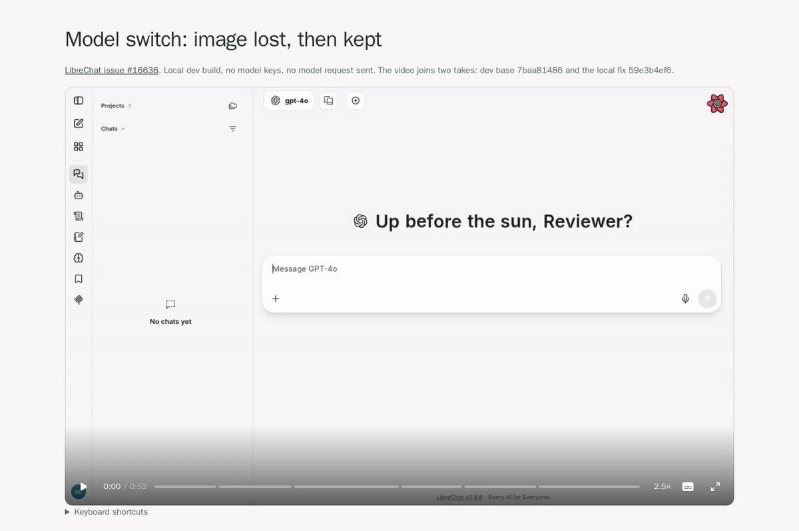

# video-review

Turn an agent's screen recording into a review page that someone can check in under a minute.



This review shows a LibreChat bug before and after the fix. One command built it from two 6-second recordings and a `steps.json`.

## Install

You need [Bun](https://bun.sh) and [FFmpeg](https://ffmpeg.org/download.html) with `ffprobe`, `libx264` and `libass` on `PATH`.

In Claude Code, the plugin adds the skill and the `video-review` command:

```sh
claude plugin marketplace add hanneslipusch/agents
claude plugin install video-review@hanneslipusch
```

For other agents, install the skill with `bunx skills add hanneslipusch/video-review` and the command from a clone:

```sh
git clone https://github.com/hanneslipusch/video-review && cd video-review && bun link
```

## Build a review

The skill gives your agent these steps. By hand, first find the times. `video-review frames recording.webm --out frames` writes one image every 0.5 s, named by its second.

Then write `steps.json`. Times are seconds in the recording, and each step ends on the result you saw. `chapter` labels the progress bar in at most 20 characters, and `text` is the caption. Optional `notes` is Markdown under the title, such as the PR link and what you did not check.

```json
{
  "title": "Search Wikipedia for FFmpeg",
  "steps": [
    { "start": 0, "end": 3.9, "chapter": "Search suggested", "text": "Typing FFmpeg listed the FFmpeg article first." },
    { "start": 3.9, "end": 6.6, "chapter": "Article opened", "text": "Enter opened the FFmpeg article." },
    { "start": 6.6, "end": 9.6, "chapter": "History shown", "text": "The page scrolled to the Project history section." }
  ]
}
```

To show another recording or a card, give the step a `source` path relative to `steps.json`. Another recording uses its own clock. A PNG or JPG card takes no `start` or `end` and holds like a result:

```json
{ "source": "what-changed.png", "chapter": "What changed", "text": "Watch the attachment when the model switches." }
```

Build the review:

```sh
video-review build recording.webm steps.json --out review
```

Serve the `review` folder with a server that answers Range requests, or the player can't seek. Python's `http.server` doesn't. A new build replaces the review in its `--out` folder and refuses any other existing folder. `video-review build --help` lists every input and output.

## What the reviewer gets

The page plays at 2.5×, and the rate button steps from 1× to 4×. Each step plays at recorded speed, then holds on its result while the caption shows. Hover a segment of the progress bar to see its chapter and a frame.

The folder also holds `video.mp4` for chat, `frames/` with one image per result, and `timeline.json` with source hashes and step times. GitHub plays only videos uploaded in its editor, so embed `preview.gif` in a pull request: it plays the review at 2.5× with the captions, and can link to the page. The [Video.js 10](https://videojs.org/) player is bundled, with no CDN.

## Add a voiceover

Pass `--voiceover` when people will listen rather than read. It needs `GEMINI_API_KEY` from [Google AI Studio](https://aistudio.google.com/apikey). Only the caption text goes to the [Gemini TTS API](https://ai.google.dev/gemini-api/docs/speech-generation). Each line's speech is cached in `~/.cache/video-review/speech`, or under `$XDG_CACHE_HOME`, so a rebuild requests only the lines that changed.

On the page, the voice speeds up by the square root of the video speed, at most 1.8×. A result plays slower until the voice finishes, so the video never stops. `video.mp4` keeps the voice at normal speed.

## Develop

```sh
bun run check
bun run test
claude plugin eval . --allow-tools Bash Write --no-publish
claude --plugin-dir .   # try the plugin from this checkout
```

Commit the generated `bin/video-review` with the source. The evals run each case with and without the skill and bill your Claude account. Their sandbox hides your home directory, so put `bun`, `ffmpeg`, `ffprobe`, and this repo's `bin/` on a `PATH` outside it. Keep private cases in `evals-private/`, which git ignores, and run them with `--eval-dir evals-private`.

`patches/` fixes the type declarations in `@videojs/html` 10.0.0 until [videojs/v10#2369](https://github.com/videojs/v10/issues/2369) ships.
